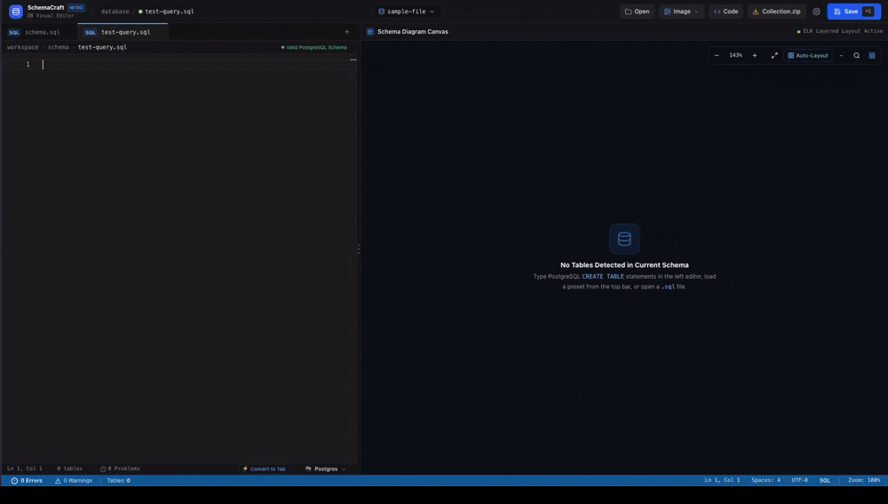
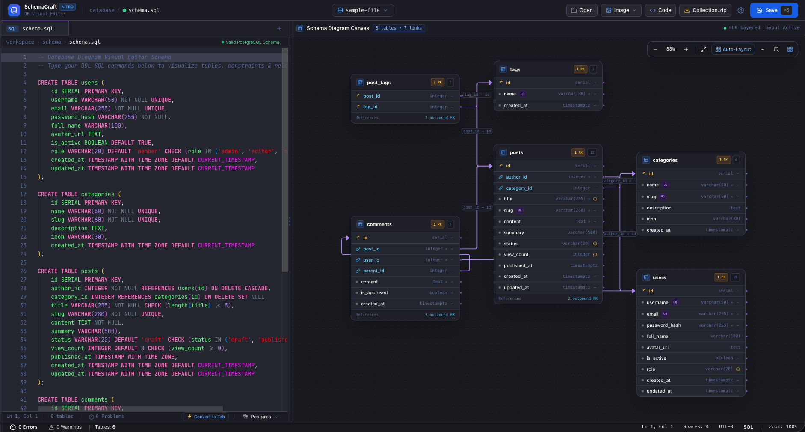

# 🏗️ SchemaCraft - Database Diagram Visual Editor

[](https://nuxt.com/)
[](https://www.postgresql.org/)
[](https://microsoft.github.io/monaco-editor/)
[](https://vueflow.dev/)
[](https://github.com/kieler/elkjs)
[](https://tailwindcss.com/)
[](https://vitest.dev/)
[](LICENSE)

**SchemaCraft** is a high-performance, developer-first visual database IDE that translates database schema code and ORM definitions into interactive, production-ready Entity-Relationship Diagrams (ERDs) in real time.

Instead of manually drawing diagram nodes or maintaining detached architectural documentation, SchemaCraft treats **code as the single source of truth**. You write PostgreSQL DDL, MySQL dumps, DBML, Prisma schemas, Drizzle definitions, or TypeORM entities on the left, and SchemaCraft continuously compiles and routes an interactive relational canvas on the right.

---

## 🎬 Visual Showcase & Demonstrations

### Live Interactive Studio Demo



_Watch SchemaCraft parse multi-table relational DDL, perform real-time AST syntax validation, auto-route foreign-key relationships, and apply layered graph auto-layout on the fly._

---

### Dual-Pane Visual Studio Layout



_The SchemaCraft dual-pane workspace: full Monaco code intelligence on the left, draggable divider, interactive Vue Flow canvas on the right, multi-tab workspace management on top, and integrated diagnostics console on the bottom._

---

## 🎯 What is SchemaCraft?

SchemaCraft bridges the gap between database engineering code and visual system design. Traditional diagramming tools require drag-and-drop shapes that quickly fall out of sync with actual migrations, while standard IDEs only provide textual feedback.

SchemaCraft solves this through a client-side architecture:

1. **Official Parser in WebAssembly:** Embeds the official PostgreSQL 13 parser compiled to WebAssembly (`pg-query-emscripten`) to validate schema syntax directly inside the browser with zero network latency.
2. **Unified Relational Model:** Parses heterogeneous dialects (PostgreSQL, MySQL/MariaDB, DBML, Prisma, Drizzle ORM, TypeORM) into a normalized JSON Schema AST (`{ tables: [], relations: [] }`).
3. **Reactive Visual Engine:** Renders custom table nodes with column types, primary/foreign key badges, and constraint flags via Vue Flow.
4. **Hierarchical Graph Layout:** Leverages Eclipse Layout Kernel (`elkjs`) to calculate non-overlapping 2D coordinates and clean orthogonal relationship edges automatically.

---

## 👥 Who is SchemaCraft for?

- **Backend Engineers & Tech Leads:** Rapidly architect database schemas, design foreign-key relationship topologies, and verify integrity constraints before writing database migrations.
- **Database Administrators (DBAs):** Inspect legacy MySQL or PostgreSQL dumps, transform disparate dialects, and visualize constraint graphs.
- **Full-Stack Developers:** Transpile existing database tables into TypeScript interfaces, Prisma models, or DBML definitions for instant project bootstrapping.
- **Educators & Students:** Learn relational database modeling, foreign key cardinality, and normal forms through visual feedback.

---

## ✨ Key Capabilities & Architectural Features

### 1. Dual Split-Pane Studio

- **Monaco Code Intelligence:** Syntax highlighting, keyword completions, bracket matching, and multi-cursor editing powered by the same engine that drives VS Code.
- **Draggable Splitter:** Smooth horizontal pane divider with a 200px safety minimum width for optimal screen space management.
- **Responsive Mobile Mode:** Mobile and tablet viewports automatically adapt to single-view focus with a floating toggle button to flip between code editing and visual diagram inspection.

### 2. Zero-Latency WebAssembly Engine

- Executes parser binaries client-side with sub-millisecond execution times.
- Zero server round-trips ensure your proprietary database schema definitions remain private within your local browser runtime.

### 3. Real-Time Syntax Validation & Diagnostics

- Monaco editor markers display red squiggly lines at the exact line and column where syntax errors occur.
- Bottom VS Code-style diagnostic console drawer (`⌘J` / `Ctrl+J`) displays problem logs and error messages with direct click-to-line navigation.

### 4. Universal MySQL & MariaDB Dialect Engine

- Heuristic detection identifies MySQL/MariaDB signatures (backtick identifiers, `AUTO_INCREMENT`, `ENGINE=InnoDB`, `DEFAULT CHARSET`, display widths like `int(11)`, and table options).
- Automatically converts MySQL DDL to PostgreSQL-compliant DDL, converting data types, mapping sequences to `SERIAL`, and stripping non-DDL statements.

### 5. Multi-Language & ORM Ecosystem

- **PostgreSQL / Standard SQL:** Native DDL parsing including `CREATE TABLE`, `PRIMARY KEY`, `FOREIGN KEY ... REFERENCES`, `UNIQUE`, `NOT NULL`, and `CHECK` constraints.
- **Database Markup Language (DBML):** Declarative table structures, column settings, table notes, and custom relationship bindings (`Ref: orders.user_id > users.id`).
- **Prisma ORM Schema:** Support for `model` blocks, `@id`, `@default()`, `@relation()`, multi-field compound indexes, and enums.
- **Drizzle ORM:** TypeScript schema declarations using `pgTable`, `serial`, `text`, `integer`, and `.references()`.
- **TypeORM:** Class-based entity declarations utilizing `@Entity()`, `@PrimaryGeneratedColumn()`, `@Column()`, and relationship decorators.

### 6. Automated ELK Hierarchical Layout

- Powered by Eclipse Layout Kernel (`elkjs`).
- Pressing `⌘S` / `Ctrl+S` or clicking **Auto Layout** computes an optimal layered graph layout, reducing edge crossings and grouping interconnected entity clusters logically.

### 7. Rich Constraint Badges & Metadata Tooltips

- Distinct visual badges for Primary Keys (`PK`), Foreign Keys (`FK`), `UNIQUE`, `NOT NULL`, and `CHECK` constraints.
- Interactive hover tooltips provide human-readable interpretations of complex check conditions, column defaults, and schema notes.

### 8. Multi-Tab Workspace & Collection Archives

- Work with up to 10 isolated database schemas simultaneously.
- Each tab maintains independent Monaco undo/redo stacks, AST caches, active dialect settings, and canvas positions.
- Double-click tabs to rename them inline.
- One-click **Collection.zip** export packages all active workspace tabs into a single compressed archive using `fflate`.

### 9. Production Export Suite & Polyglot Transpiler

- **Diagram Exports:** Export diagrams to high-resolution 2x PNG, vector SVG, or compressed JPEG.
- **Code Transpilation:** Convert your schema into TypeScript Interfaces, Prisma Schema models, DBML, or PostgreSQL DDL.

### 10. Curated Developer Theme Suite

- **Midnight Slate:** Modern, neutral dark studio palette.
- **Monokai Classic:** High-contrast palette with vibrant pinks, yellows, greens, and cyans across the editor and canvas.
- **Dracula Dark:** Refined purple nocturnal aesthetic.
- **Nordic Frost:** Cool, muted slate-blue environment.
- **Clean Light:** High-contrast daylight theme for documentation captures and daylight presentations.

---

## ⌨️ Keyboard Shortcuts Reference

| Command / Action              | macOS            | Windows / Linux | Description                                                      |
| :---------------------------- | :--------------- | :-------------- | :--------------------------------------------------------------- |
| **Save & Auto-Layout**        | `⌘ + S`          | `Ctrl + S`      | Saves active tab and recalculates ELK graph layout               |
| **New Tab**                   | `⌘ + N`          | `Ctrl + N`      | Creates a new schema tab (up to 10 tabs)                         |
| **Close Tab**                 | `⌘ + W`          | `Ctrl + W`      | Closes active tab session                                        |
| **Find & Focus Table**        | `⌘ + K`          | `Ctrl + K`      | Opens quick table search palette and centers canvas on selection |
| **Toggle Diagnostic Console** | `⌘ + J`          | `Ctrl + J`      | Toggles bottom problems/error console drawer                     |
| **Zoom Canvas**               | `Scroll / Pinch` | `Ctrl + Scroll` | Smoothly zooms in or out of the diagram workspace                |
| **Pan Workspace**             | `Space + Drag`   | `Space + Drag`  | Pans diagram canvas in any direction                             |
| **Fit View**                  | Click `Fit`      | Click `Fit`     | Centers and frames entire diagram within the canvas viewport     |
| **Rename Tab**                | `Double Click`   | `Double Click`  | Edits schema tab title inline                                    |

---

## 🚀 Quick Start & Installation

### Prerequisites

- **Node.js**: v18.0.0 or higher (LTS recommended)
- **npm**, **pnpm**, or **yarn**

### Local Setup Steps

1. **Clone the Repository:**

   ```bash
   git clone https://github.com/clinton9ice/SchemaCraft.git
   cd SchemaCraft
   ```

2. **Install Dependencies:**

   ```bash
   npm install
   ```

3. **Start the Development Server:**

   ```bash
   npm run dev
   ```

4. **Access the Application:**
   Open your browser and navigate to `http://localhost:9000` (or `http://localhost:3000`).

---

## 🧪 Testing & Quality Assurance

SchemaCraft enforces a strict testing and code quality workflow.

```bash
# Run unit, composable, and parser test suite via Vitest
npm run test

# Run linter checks
npm run lint

# Format codebase with Prettier
npm run format
```

All pull requests and commits are verified against automated Husky hooks (`lint-staged` with ESLint and Prettier) and must pass all unit and integration test suites.

---

## 📁 Project Architecture & Directory Structure

```text
├── assets/                  # Lucide SVG icons and global CSS styles
│   └── svg/                 # Structured SVG icon directories
├── components/              # Vue 3 component suite
│   ├── features/
│   │   ├── canvas/          # Vue Flow canvas, table nodes, controls, minimap
│   │   └── editor/          # Monaco editor, error console, tab manager, dialect modal
│   ├── shared/              # Header, status bar, modals, search palettes
│   └── tools/               # Global Icon component
├── composables/             # Nuxt 3 Composition API state managers
│   ├── use-schema-parser.ts # WASM parser & AST compilation coordinator
│   ├── use-theme.ts         # Theme engine (Monokai, Dracula, Slate, Light)
│   ├── use-layout.ts        # ELKjs auto-layout integration
│   └── use-upload-queue.ts  # Multi-file batch upload queue
├── docs/                    # Architectural design documentation
├── pages/
│   ├── index.vue            # Main dual-pane visual studio
│   └── docs.vue             # In-app interactive documentation hub
├── public/                  # Static assets (demo.gif, editor-layout.png, sample schemas)
├── tests/                   # Vitest unit and integration test suites
└── utils/                   # Pure AST compilers, dialet transformers, sanitizers
```

---

## 📄 License

This project is licensed under the **MIT License**. See the [LICENSE](LICENSE) file for details.

---

## 💡 Contributing

Contributions, issues, and feature requests are welcome! Feel free to open a pr with a tag of issue, pending when issue page is setup
